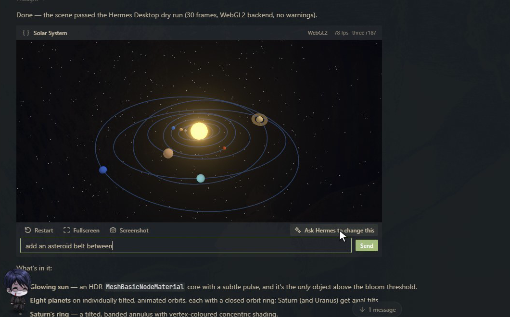

# Three.js Stage

Live three.js r187 scenes and 3D models in Hermes chat.

Ask Hermes for anything 3D, like "show me a double pendulum", "visualise this point cloud" or
"a low-poly island at sunset". Hermes writes a scene and calls `three_scene`. In Hermes Desktop
the reply contains a live card you can orbit, restart, expand to fill the Hermes window, and
screenshot. If the scene breaks, the card shows the error with the failing line, and **Fix with Hermes** sends it back so
Hermes can repair it. **Ask Hermes to change this** sends a follow-up request about that scene.

It also shows model files. Ask "show me `C:/models/robot.glb`" and you get the same card, with
the model lit, framed and animated, plus its format, triangle, mesh and animation counts. GLB,
GLTF, STL and OBJ are supported, including `.bin`, `.mtl` and texture files beside the model.

Outside Desktop (CLI, TUI, messaging), the same call delivers a standalone `.html` file that runs
the scene in any browser.



## Using the card

- **Drag** to orbit, **right-drag** to pan. The mouse wheel scrolls the chat until you click the
  scene; after that it zooms, until the pointer leaves the card. In fullscreen it always zooms.
- **Restart** runs the scene again from the start. **Fullscreen** fills the Hermes window
  (Escape leaves). **Screenshot** saves a PNG on the machine Hermes runs on and shows its path.
- **Ask Hermes to change this** opens a box for a follow-up such as "make it night and add fog".
- Cards stop rendering when scrolled off screen, and after 30 seconds off screen they release
  their GPU context. They start again when you scroll back.

## Hermes checks its own work

With Desktop open, every `three_scene` call runs the scene for one simulated second in a hidden
sandboxed frame before the tool returns. If it crashes, Hermes gets the error and the failing line
in the same turn and repairs it, so you never see the broken version. If it runs but draws nothing
or comes out black, Hermes is told that too. A prompt or skill alone can't do this, because the
model can't see what its own code does on a real GPU.

## What's in the package

| Part | What it does |
|---|---|
| `three_scene` tool | Statically checks the scene against the r187 contract (imports, renderer misuse, GLSL, storage, loop ownership) and validates model files. It rejects problems in the same turn, stores the scene, and returns a `MEDIA:` line. |
| `threejs-stage:three-r187` skill | The scene contract, the WebGL2-vs-WebGPU rules, bundled addons, and recipes (environment lighting, shadows, instancing, bloom, TSL materials). |
| Desktop card | A tool media renderer for `three_scene`. It runs the scene in a `SandboxedFrame` whose content security policy blocks network access, and pauses rendering when scrolled out of view. |
| Backend (`dashboard/plugin_api.py`) | Serves the vendored three.js r187 to the card, serves scene records and stored models (by scene id, never by path), and saves screenshots. |

## Requirements and install

- Hermes `>= 0.22.7`. The card needs a Desktop build with tool media renderers.
- `hermes plugins install threejs-stage`, then enable it for the profile
  (`hermes plugins enable threejs-stage`) and turn on its Desktop half in **Capabilities → Plugins**.
- Restart the gateway once after installing, so the plugin's backend routes are mounted.

## Disclosures

- **Code execution.** Scene code written by the model runs in Hermes Desktop inside a sandboxed
  iframe (`allow-scripts allow-pointer-lock`, opaque origin). It cannot reach the app, its
  storage, cookies or the native bridge. It runs on your GPU, so a heavy scene can use
  noticeable GPU and CPU while visible. Cards pause when scrolled off screen.
- **Network.** The Desktop card cannot use the network. three.js comes from this plugin's own
  backend, and the frame's content security policy (`default-src 'none'`, with only `blob:` and
  `data:` sources allowed) blocks every request scene code could make. The exported `.html` file
  is different: it loads three.js 0.187.0 from `cdn.jsdelivr.net` when you open it in a browser,
  and has no such policy.
- **Files read and written.** When Hermes passes a model path, the tool reads that file and the
  `.bin`, `.mtl` and image files it references. References that leave the model's folder are
  refused. It copies them to `<HERMES_HOME>/plugin-data/threejs-stage/models/`. Scene records go to
  `.../plugin-data/threejs-stage/scenes/`, screenshots to `.../plugin-data/threejs-stage/screenshots/`,
  and delivered files to `<HERMES_HOME>/cache/generated/threejs-stage/`. Nothing is deleted
  automatically; these folders are safe to clear, at the cost of old cards no longer reopening.
- **Hidden dry runs.** With Desktop open, each `three_scene` call runs the scene briefly in a
  hidden sandboxed frame. The tool waits up to 2.5 seconds for Desktop to pick it up, and up to
  16 more for the result. Each automatic repair is a normal model call and uses tokens. Turn this
  off with the `verify_scenes` setting.
- **Cost.** No API keys, no paid services, no telemetry, no background processes. **Fix with
  Hermes** and **Ask Hermes to change this** each send one ordinary chat message, which uses
  model tokens like any message you type.

## Model limits

- 50 MB total per model. Above 25 MB, non-Desktop surfaces get the model file itself rather than
  an HTML viewer.
- Draco, meshopt and KTX2/Basis compressed glTF files are refused, because their decoders are
  binaries this package does not ship. Export without compression.
- OBJ uses the first `.mtl` file it references. Textures must be PNG, JPEG or WebP.

## WebGPU vs WebGL2

`SandboxedFrame` documents with a `data:` URL are not a secure context, so `navigator.gpu` is
absent and `WebGPURenderer` runs on its WebGL2 backend. The card shows which backend is in use.
On WebGL2, TSL atomics silently return 0 and storage textures throw. The skill tells Hermes to
guard both. Measurements are in [`probe/RESULTS.md`](probe/RESULTS.md).

## Development

```bash
node scripts/vendor-three.mjs <unpacked three@0.187.0 package>   # refresh vendor/three
node scripts/build.mjs                                            # desktop/src → desktop/plugin.js
hermes plugins doctor . && hermes plugins validate .
```

## License

MIT. Bundles three.js r187 (MIT, © three.js authors): see `vendor/three/LICENSE`.
